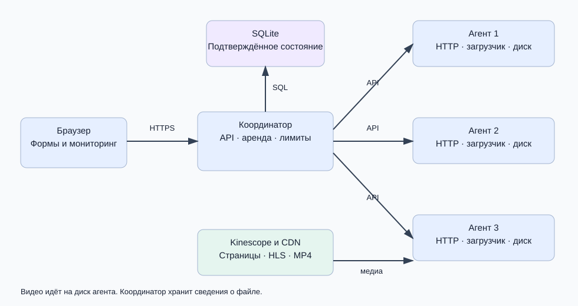
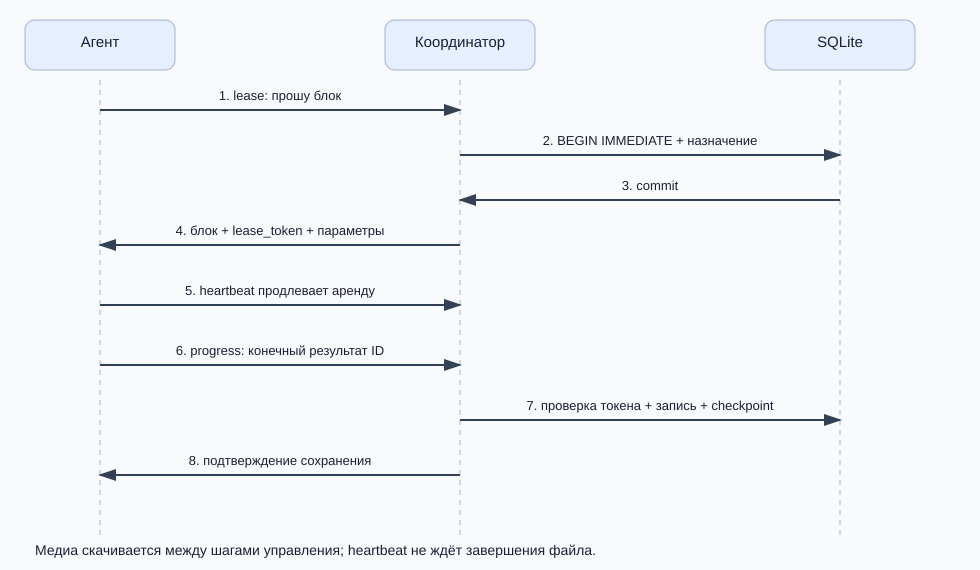
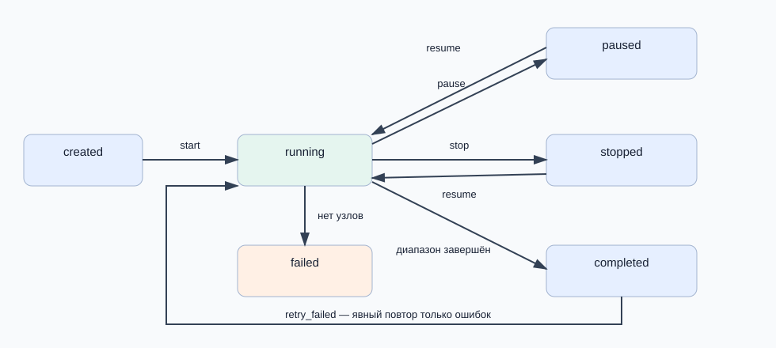
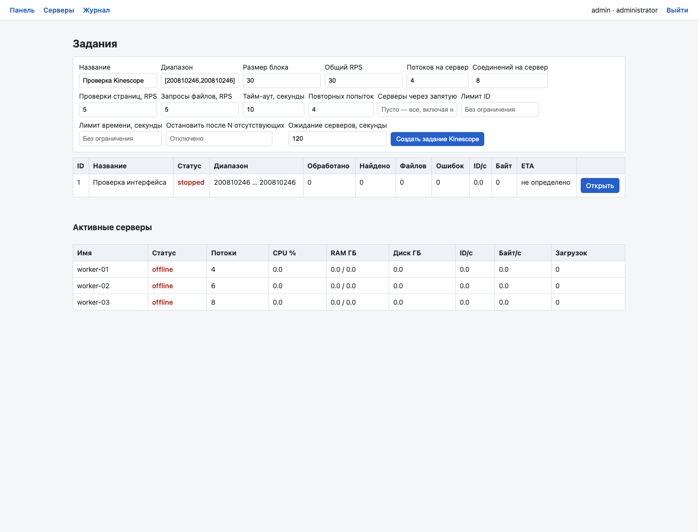
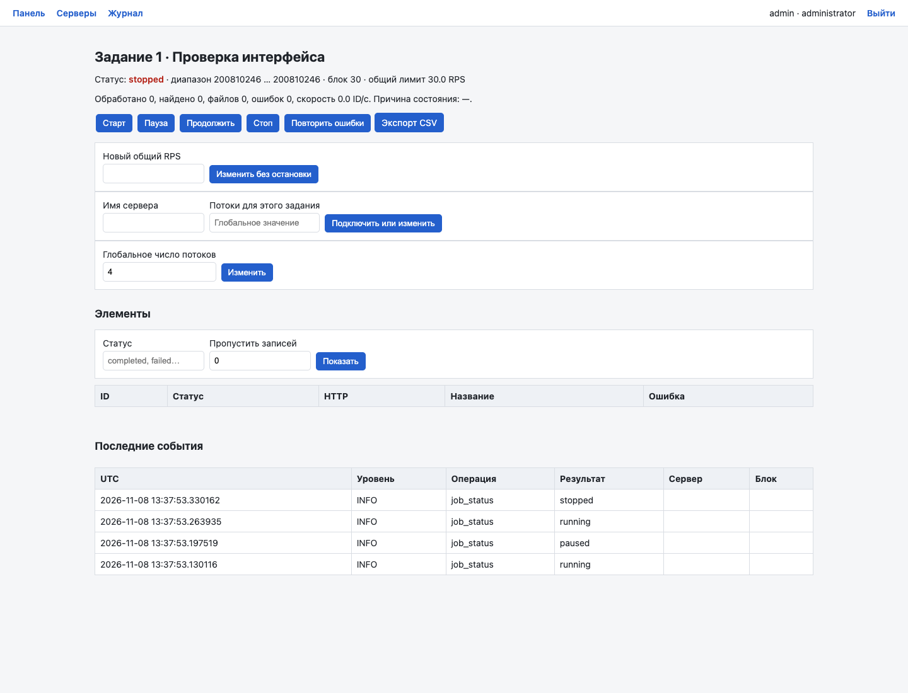

# Как устроен Video Harvester

## 1. Что делает программа

Никита, этот проект решает одну задачу: распределяет проверку числовых идентификаторов видео между несколькими рабочими серверами и сохраняет доступные медиафайлы. Человек задаёт диапазон и ограничения в веб-интерфейсе. Дальше координатор следит за состоянием, а агенты выполняют сетевую работу.

Например, диапазон `[200810246,200810246]` содержит ровно один ID. Агент открывает `https://kinescope.io/200810246`, находит параметры плеера, получает адрес HLS, загружает видео и звук, собирает MP4 и сообщает результат. Координатор записывает, кто сохранил файл, где он находится, сколько занимает и какую имеет контрольную сумму.

В новой версии это настоящий путь работы. В рабочей конфигурации адресом источника является Kinescope. Локальный тестовый сервис нужен только для проверок: иначе нельзя безопасно и воспроизводимо вызвать обрыв, 500, 429 или сотню одновременных запросов.

Наличие страницы не означает, что любой материал можно скачать. Программа работает с открытым незашифрованным источником. Если нужны авторизация, DRM-ключи или лицензия, она сохраняет запрет или явную ошибку. Она не создаёт вместо видео файл с фиктивными байтами в рабочем режиме.

## 2. Почему нужны несколько компонентов

Представим три рабочих сервера. Если заранее отдать каждому треть большого диапазона, быстрый сервер закончит раньше и будет ждать медленный. Если медленный выключится, его большая часть останется необработанной.

Поэтому координатор выдаёт небольшие блоки. Освободившийся агент просит следующий. Быстрый сервер естественным образом выполняет больше блоков. Если агент пропал, координатор возвращает его незавершённый блок в очередь.



У компонентов разные обязанности:

| Компонент | Что делает | Чего от него ждать не нужно |
|---|---|---|
| Браузер | Формы, кнопки, таблицы, просмотр состояния | Сам не скачивает видео и не хранит SSH-ключи |
| Координатор | Задания, права, выдача блоков, контроль аренды, общие лимиты, БД | Не передаёт через себя весь видеопоток |
| Агент | Проверяет страницы, загружает медиа, проверяет файл, сообщает прогресс | Не решает самостоятельно, какой глобальный диапазон ему принадлежит |
| SQLite | Подтверждённое состояние и журнал | Не хранит сами большие видео |
| FFmpeg и ffprobe | Собирают локальные дорожки и проверяют медиа | Не ходят на сайт за агентом |
| Диск рабочего сервера | MP4, метаданные и временные части | Не является общей папкой всех узлов автоматически |

Здесь HTTP API — набор адресов и форматов сообщений между программами. REST-эндпоинт `/api/jobs` создаёт или возвращает задания. Эндпоинт `/lease` выдаёт работу. Это обычные HTTP-запросы, поэтому координатор и агент могут находиться на разных машинах.

## 3. Как читать проект

Начни с `README.md`: это инструкция запуска. Затем прочитай файлы в таком порядке:

1. `coordinator/db.py`: какие сущности существуют и что сохраняется.
2. `coordinator/service.py`: как выдаётся работа и проверяется право на результат.
3. `coordinator/app.py`: как эти действия доступны через HTTP и формы.
4. `agent/agent.py`: основной цикл рабочего узла.
5. `agent/sources.py`: как страница превращается в сведения о видео.
6. `agent/http.py`: как проходят все запросы к источнику.
7. `agent/downloader.py`: как байты превращаются в проверенный файл.

Полная карта:

```text
video-harvester/
├── coordinator/
│   ├── app.py          HTTP API, страницы, управление
│   ├── service.py      блоки, аренда, checkpoint, общий лимит
│   ├── db.py           SQLAlchemy-модели и транзакции
│   ├── migrate.py      миграция существующей БД к схеме 2
│   ├── security.py     роли, пароли, сессии, токены
│   └── templates/      HTML-интерфейс
├── agent/
│   ├── agent.py        жизненный цикл рабочего узла
│   ├── http.py         HTTP, отмена, лимиты, проверка адресов
│   ├── sources.py      Kinescope и отдельный тестовый адаптер
│   └── downloader.py   MP4, HLS, Range, целостность, remux
├── common/             версия протокола и проверка путей
├── mock_target/        только управляемые испытания
├── tests/              модульные и интеграционные тесты
├── scripts/            установка, реальные процессные проверки
├── migrations/         исходная SQL-схема версии 1
├── docs/               это руководство, API, отчёты и схемы
└── config.example.yaml образец конфигурации без секретов
```

FastAPI связывает HTTP-адрес с Python-функцией. Pydantic проверяет входные числа, строки и обязательные поля. SQLAlchemy представляет строки БД объектами. HTTPX выполняет запросы. psutil читает ресурсы машины. m3u8 разбирает HLS-плейлисты. Jinja2 формирует HTML-страницы.

## 4. Задание, блок и отдельный ID

**Задание** — весь запуск с диапазоном и настройками. **Блок** — небольшая часть этого диапазона, передаваемая одному агенту. **Элемент** — один проверяемый ID. Это три разные сущности.

Если задан диапазон `[100,109]` и размер блока 4, появляются блоки `[100,103]`, `[104,107]`, `[108,109]`. Границы включительные: в первом блоке четыре ID, а не три.

Поддерживаемые формы ввода:

| Ввод | Значение |
|---|---|
| `[10,20]` | От 10 до 20 включительно |
| `20` | От 0 до 20 включительно |
| `[100,]` | Начать со 100, верхняя граница открыта |
| Пусто | Начать с 0, верхняя граница открыта |

Координатор отвергает отрицательные числа, обратные границы и числа вне поддерживаемого диапазона 64-битного целого. Ошибка формы даёт понятный ответ 422, а не необработанный сбой сервера.

В старой версии координатор заранее создавал все блоки конечного диапазона. Для очень большого диапазона это расходовало память и надолго задерживало создание задания. Сейчас `next_range_start` хранит начало следующей ещё не созданной части. Новый блок появляется только при запросе работы. Число строк растёт по мере выполнения.

`stop_after_ids` учитывается при вычислении последнего разрешённого ID. Поэтому ограничение «обработать 3 ID» не превращается в выдачу трёх полных блоков. Ограничение времени проверяет также фоновое обслуживание координатора, а не только запрос очередного блока.

## 5. Как агент получает работу



Сначала агент регистрируется. Координатор проверяет персональный токен и версию протокола. Затем агент сообщает ресурсы: CPU, память, диск. Только после этого он просит блок.

В ответ приходят:

- `job_id` и `chunk_id`: какое задание и какой блок;
- `range_start`, `range_end`, `next_id`: границы и точка продолжения;
- `lease_token`: уникальное значение именно этой выдачи;
- `skip_ids`: уже подтверждённые ID, которые не надо загружать снова;
- тайм-аут, число повторов, потоки, соединения, источник, каталог и резерв диска.

**Аренда** означает временное право выполнять блок. Если срок закончился, старый агент больше не может подтверждать результаты. Периодический heartbeat продлевает это право.

В старой версии heartbeat отправлялся между пачками. Большой файл мог загружаться дольше срока аренды. Другой сервер получал тот же блок, хотя первый продолжал работать. Сейчас heartbeat — отдельный поток с отдельным HTTP-клиентом. Чтение медиа не занимает канал управления.

Координатор возвращает признак `lease_renewed`. Если продление не удалось или сервер отключён, агент устанавливает сигнал отмены. При потере координатора агент также не продолжает бесконтрольно работать: он прекращает операции до истечения предполагаемого срока своей аренды.

## 6. Почему одного имени агента недостаточно

Представим: worker-01 получил блок, отключился и через минуту вернулся. Блок к этому моменту уже мог снова попасть worker-01, но это другая попытка. Проверка только имени не отличит старое сообщение от нового.

Поэтому у каждой выдачи собственный `lease_token`. Даже при одинаковом имени и номере блока токен будет другим. Это называется fencing: старую попытку отсекают от изменения актуального состояния.

Ключевой фрагмент проверки владельца:

Источник: [coordinator/service.py](../coordinator/service.py).

```python
def owned(s, name, job_id, chunk_id, token, allow_done=False):
    chunk = s.get(RangeChunk, chunk_id)
    job = s.get(Job, job_id)
    if (
        not job
        or not chunk
        or chunk.job_id != job_id
        or chunk.leased_by != name
        or not token
        or chunk.lease_token != token
    ):
        raise Conflict("Блок принадлежит другой попытке или агенту")
    if allow_done and chunk.status == "done":
        return job, chunk
    if (
        chunk.status != "leased"
        or not chunk.lease_expires_at
        or chunk.lease_expires_at <= utcnow()
        or job.status not in {"running", "paused"}
    ):
        raise Conflict("Аренда истекла или задание остановлено")
    return job, chunk
```

Здесь проверяются не только имя и токен, но и принадлежность блока заданию, состояние работы и срок аренды. Проверка происходит до записи результата.

Раньше API сначала менял `items`, делал commit, а затем пытался продлить аренду. В итоге ответ мог сказать «аренда не продлена», но ошибочная запись уже находилась в БД. Теперь проверка и сохранение составляют одну транзакцию.

## 7. Транзакция и защита от одновременной выдачи

Транзакция объединяет несколько операций в одно изменение: либо все они зафиксированы, либо ни одна. Для SQLite используется `BEGIN IMMEDIATE`, который заранее получает право записи.

Источник: [coordinator/db.py](../coordinator/db.py).

```python
@contextmanager
def transaction():
    """SQLite's write lock spans the entire read/validate/write transaction.

    Unlike threading.Lock this also serializes independent API processes.
    """
    session = Session()
    try:
        if DATABASE_URL.startswith("sqlite"):
            session.execute(text("BEGIN IMMEDIATE"))
        yield session
        session.commit()
    except BaseException:
        session.rollback()
        raise
    finally:
        session.close()
```

Это нужно потому, что последовательность «найти свободный блок → назначить владельца» состоит из нескольких шагов. Без общей блокировки два HTTP-запроса могут оба прочитать один и тот же свободный блок.

Старый `threading.Lock` защищал только один Python-процесс. Новая блокировка находится на уровне SQLite и действует между процессами. SQLite всё равно остаётся СУБД одного узла: это не превращает её в отказоустойчивый кластер и не разрешает класть файл БД на произвольный сетевой диск.

## 8. Как считается подтверждённый прогресс

`next_id` — первый ID, перед которым весь предыдущий участок блока уже подтверждён. Это не «самый большой номер, который когда-либо сообщил агент».

Пример: поток для ID 102 завершился раньше 100 и 101. Сохранить результат 102 можно, но `next_id` пока остаётся 100. Когда готов 100, указатель становится 101. Когда готов 101, он перескакивает на 103, потому что 102 уже есть в БД.

Источник: [coordinator/service.py](../coordinator/service.py).

```python
def advance(s, chunk):
    rows = (
        s.query(Item)
        .filter(
            Item.job_id == chunk.job_id,
            Item.external_id >= chunk.next_id,
            Item.external_id <= chunk.range_end,
        )
        .order_by(Item.external_id)
        .all()
    )
    cursor = chunk.next_id
    for item in rows:
        if item.external_id != cursor or item.status not in TERMINAL:
            break
        cursor += 1
    chunk.next_id = max(chunk.next_id, cursor)
```

Агент не может сдвинуть checkpoint произвольным числом. Его старое сообщение не уменьшает указатель. Запоздавший повтор подтверждённого результата не меняет конечный статус и не создаёт новую запись.

Если процесс падает после сохранения файла, но до подтверждения БД, этот результат ещё не считается подтверждённым. На том же диске файл можно переиспользовать по метаданным и SHA-256. Если блок ушёл на другую машину, там может потребоваться повторное скачивание. Это допустимое следствие модели **at least once**: система гарантирует повтор незавершённой работы, а не ровно одну физическую сетевую операцию при любом сбое.

## 9. Настоящий Kinescope вместо JSON-заглушки

У тестового сервиса ответ был JSON. Kinescope отдаёт HTML с параметрами плеера. Поэтому старый `response.json()` приводил к `bad_json` даже при HTTP 200.

Новый адаптер находит объявление `playerOptions` и разбирает JSON внутри него. JavaScript страницы не выполняется. Из первой записи плейлиста извлекаются название, длительность и публичный адрес источника. HTML не скачивается как будто это MP4.

Источник: [agent/sources.py](../agent/sources.py).

```python
def discover(http, source, base_url, video_id):
    url = f'{base_url.rstrip("/")}/{video_id}'
    body, resolved, headers = http.get(url)
    if source == "mock":
        try:
            data = json.loads(body)
        except (ValueError, UnicodeError) as e:
            raise SourceError("invalid_test_json") from e
        if not isinstance(data, dict) or not isinstance(data.get("download_url"), str):
            raise SourceError("invalid_metadata")
        return dict(
            external_id=video_id,
            title=str(data.get("title", "")),
            source_url=url,
            download_url=urljoin(resolved, data["download_url"]),
            mime=data.get("mime", "application/octet-stream"),
            expected_size=data.get("size"),
            expected_checksum=data.get("checksum"),
            kind="direct",
        )
    if source != "kinescope":
        raise SourceError("unknown_source")
    html = body.decode("utf-8", errors="replace")
    match = re.search(r"\b(?:var|let|const)\s+playerOptions\s*=\s*", html)
    if not match:
        raise SourceError("player_metadata_missing")
    try:
        options, _ = json.JSONDecoder().raw_decode(html[match.end() :])
    except ValueError as e:
        raise SourceError("invalid_player_metadata") from e
    if not isinstance(options, dict):
        raise SourceError("invalid_player_metadata")
    playlist = options.get("playlist") or []
    if (
        not isinstance(playlist, list)
        or not playlist
        or not isinstance(playlist[0], dict)
    ):
        raise SourceError("empty_playlist")
    item = playlist[0]
    # Do not fetch keys, license servers, login/cookie gated media or DRM formats.
    if item.get("drm") or item.get("license") or item.get("drmProtected"):
        raise SourceError("protected_media", 403)
    sources = item.get("sources", {})
    if not isinstance(sources, dict):
        raise SourceError("invalid_media_sources")
    meta = item.get("meta") or {}
    if not isinstance(meta, dict):
        raise SourceError("invalid_media_metadata")
    hls = sources.get("hls") or sources.get("shakahls")
    direct = sources.get("mp4")
    selected = hls or direct
    if isinstance(selected, str):
        selected = {"src": selected}
    if not isinstance(selected, dict) or not isinstance(selected.get("src"), str):
        raise SourceError("no_public_media_source")
    if selected.get("drm"):
        raise SourceError("protected_media", 403)
    return dict(
        external_id=video_id,
        title=str(item.get("title") or ""),
        source_url=url,
        download_url=urljoin(resolved, selected["src"]),
        mime="video/mp4",
        expected_size=None,
        expected_checksum=None,
        kind="hls" if hls else "direct",
        duration=meta.get("duration"),
    )
```

Возвращается единая структура метаданных. Следующие компоненты уже не должны разбираться в устройстве HTML. Они получают `kind: hls` или `kind: direct`, `download_url`, `source_url`, название и ожидаемые характеристики.

Этот подход отделяет особенности сайта от очереди и хранения. Если формат страницы изменится, править в первую очередь надо адаптер источника. При неизвестном формате программа честно отмечает ошибку, а не объявляет загрузку успешной.

## 10. Как HLS превращается в MP4

HLS — это плейлист с адресами или диапазонами фрагментов. Главный плейлист может перечислять качества 360p, 480p, 720p и 1080p. Отдельный плейлист содержит видео, отдельный — звук.

Порядок действий:

1. Скачать главный `.m3u8` через общий HTTP-клиент.
2. Выбрать качество не выше `max_height`, если оно есть.
3. Получить видеоплейлист и связанную аудиодорожку.
4. Убедиться, что это конечная незашифрованная запись.
5. Скачать начальный блок и медиафрагменты с возможностью продолжения.
6. Собрать локальные дорожки в правильном порядке.
7. Передать локальные файлы FFmpeg для remux без перекодирования.
8. Проверить результат через ffprobe: наличие видео, длительность и контейнер.
9. Вычислить SHA-256, сохранить метаданные и сообщить координатору.

В примере преподавателя множество HLS-фрагментов ссылается на соседние диапазоны одних и тех же MP4-объектов. Загрузчик объединяет соседние диапазоны одного объекта, а большие ответы запрашивает короткими частями до 8 МиБ с сохранением общей точки продолжения. Это уменьшает число запросов, не меняя порядок байтов. Границы между разными объектами не объединяются.

FFmpeg получает только локальные пути и ограниченный набор протоколов `file,pipe`. Если передать ему удалённый HLS напрямую, его сетевые запросы прошли бы мимо центрального лимита. Поэтому загрузка сети и сборка контейнера здесь разделены.

Несколько частей могут загружаться одновременно, но все проходят через один семафор соединений агента и разрешения координатора. DRM, зашифрованный HLS, бесконечные live-потоки и HLS со сменой временной шкалы в эту реализацию не входят: для них возвращается явный статус причины.

## 11. `.part`, Range и контрольная сумма

Файл сначала пишется во временный путь. Пока проверка не закончена, его нельзя объявлять готовым. После успеха `os.replace` атомарно заменяет итоговый путь.

Рядом с частичной загрузкой хранится checkpoint: размер записанной части, SHA-256, ожидаемый общий размер и HTTP-валидатор, если сервер его предоставил. При возобновлении программа проверяет, что часть не была изменена и относится к тому же ресурсу.

Если сохранено 1000 байт, запрос продолжения содержит `Range: bytes=1000-`. Ответ 206 должен начинаться ровно с этого смещения. Нельзя просто дописать любой ответ: если сервер игнорирует Range и возвращает весь файл с 200, обычная загрузка начинается заново.

При известной контрольной сумме источника проверяется и она. SHA-256 без эталонной суммы не доказывает подлинность внешнего контента; он позволяет обнаруживать локальное изменение уже записанных данных. Реальный MP4 дополнительно проверяется ffprobe.

Особый случай: файл целиком записан, но процесс упал непосредственно перед переименованием. Старый код запрашивал Range после конца и получал 416. Новый сначала проверяет готовую часть и может завершить её без сетевого запроса.

Перед записью проверяется свободное место с учётом резерва. Для HLS требуется место под промежуточные файлы и сборку. Если места мало, работа получает явную причину, новые блоки перегруженному серверу не выдаются.

## 12. Потоки, соединения и запросы в секунду

Это три разных ограничения:

| Настройка | Что ограничивает | Пример |
|---|---|---|
| `threads` | Количество одновременно обрабатываемых ID | 8 ID могут находиться на разных этапах |
| `max_connections` | Одновременные обращения к источнику внутри агента | Не больше 4 сетевых соединений |
| RPS | Частоту начала запросов | Не больше заданной частоты, даже если потоков много |

Поток может ждать разрешение на запрос или заниматься локальным файлом. Поэтому число потоков не равно числу активных сетевых соединений.

Старое деление глобального RPS на число агентов было ненадёжным. Первый агент получал 20, затем подключался второй и получал 10, а первый ещё продолжал использовать 20. Сумма становилась 30 при глобальном лимите 20.

Теперь перед каждым внешним HTTP-запросом агент спрашивает координатор. Тот в транзакции проверяет три ограничителя: общий для задания, отдельный для `check` или `download` и общий для рабочего сервера. Разрешение выдаётся сейчас либо не выдаётся с указанием ожидания. Будущие разрешения не накапливаются.

Через этот механизм проходят также редиректы, HLS-плейлисты и медиафрагменты. При росте 429 и 5xx координатор уменьшает общий множитель нагрузки. При хорошем окне ответов постепенно восстанавливает его.

Лимит относится к началу запроса, а не к каждому мегабайту внутри уже открытого ответа. Скорость передачи байтов — отдельная характеристика сети. Настройки предельной нагрузки сети и диска влияют на выдачу новых блоков.

## 13. Повторы и честные ошибки

Сбой сети не равен отсутствию видео. В программе это разные причины:

- 404 при проверке страницы — `not_found`;
- 401/403 — `forbidden`, без обхода;
- 429 и временные 5xx — повтор с задержкой;
- неизвестная структура источника — явная ошибка адаптера;
- несовпадение размера или суммы — загрузка не подтверждается;
- исчерпание попыток — `failed` с диагностическим кодом.

Повторяется полный цикл до готового проверенного файла. Уже скачанные и проверенные части используются повторно. Для каждой попытки фиксируются номер, начало, окончание и причина ошибки.

Задержка растёт экспоненциально и содержит случайную добавку. Если источник прислал `Retry-After`, используется его значение, включая вариант в виде HTTP-даты. Во время ожидания heartbeat продолжает работать.

Кнопка «Повторить ошибки» — отдельная операция. Она сбрасывает ошибочные элементы, возвращает соответствующие блоки и переводит задание в `running`. Хорошие подтверждённые элементы остаются в `skip_ids`. Если блоки ещё активны, нужно сначала остановить задание: нельзя одновременно сбрасывать работу и принимать её старые результаты.

## 14. Состояния задания



`created` означает, что параметры сохранены, но работа ещё не разрешена. `running` разрешает выдачу блоков. `paused` запрещает новые ID и блоки; уже начатые операции могут закончиться. После этого остаток блока возвращается.

`stopped` означает немедленную команду отмены. Координатор отзывает аренду, агент получает это через heartbeat и прекращает сетевую обработку при ближайшей проверке отмены. Если поток заблокирован внутри сетевого чтения, верхняя практическая граница задержки связана с настроенным HTTP timeout. Обещать физическое прекращение любой операции за ноль миллисекунд было бы неверно.

`completed` означает, что диапазон или заданное условие завершены. Это не утверждение, что все ID содержали видео или что не было `failed`: итоговые счётчики нужно смотреть отдельно. `failed` на уровне задания применяется, например, если слишком долго нет работоспособных узлов.

Из `completed` нельзя нажать обычное «Продолжить». Для ошибочных элементов есть явная операция повтора, которая создаёт новую попытку работы с нужными блоками. Это различие сохраняет смысл истории.

## 15. Что хранится в базе

| Таблица | Смысл |
|---|---|
| `users`, `roles`, `user_roles` | Пользователи и права |
| `workers` | Конфигурация и последнее состояние узла |
| `worker_metrics` | История технических и прикладных метрик |
| `jobs` | Диапазон, параметры, состояние |
| `job_workers` | Участники задания, индивидуальные потоки |
| `range_chunks` | Блок, владелец, попытка, токен, срок, checkpoint |
| `items` | Результат каждого ID в задании |
| `media_metadata` | Обнаруженные метаданные |
| `downloads` | История попыток загрузки |
| `files` | Подтверждённый путь, размер и контрольная сумма |
| `events` | Технические события |
| `audit_log` | Кто из пользователей выполнил действие |
| `rate_buckets` | Общее состояние ограничителей запросов |

Ограничение уникальности `(job_id, external_id)` защищает от двух записей одного ID в одном задании. Уникальная связь файла с элементом защищает от двух подтверждённых файлов для этого результата. Она не удаляет неподтверждённые файлы на дисках выключенных серверов.

В новой версии миграция запускается идемпотентно: повторный старт не добавляет одинаковую колонку заново. Существующие задания, результаты и файлы сохраняются. Добавляются поля и индексы, а старые аренды без fencing token возвращаются в очередь.

## 16. Что видно в интерфейсе

На главной странице создаётся задание и показываются диапазон, обработанные ID, найденные материалы, файлы, ошибки, скорость и ETA. Для открытого диапазона ETA не определено. Средняя скорость считается по времени задания, текущая — по последнему интервалу метрик.

В карточке задания находятся управление, фильтр результатов, журнал, назначение рабочего сервера и глобальные потоки. На странице серверов видны CPU, RAM, свободное место, активные проверки, активные файлы, их байты и проценты, сеть, дисковый I/O и heartbeat.

Live-области обновляются раз в три секунды. Формы при этом не перезагружаются целиком, поэтому введённое значение не должно исчезать во время настройки. В браузере телефона широкие таблицы прокручиваются горизонтально.

Примеры интерфейса после проверки форм:





История попыток и аудит доступны также через API. Это полезно при защите: можно показать не только красивую страницу, но и сохранённые факты о выполнении.

## 17. Локальная установка пошагово

### Подготовка

Установи Python 3.11 или новее, FFmpeg и OpenSSL. Проверь:

```bash
python3 --version
ffmpeg -version
ffprobe -version
openssl version
```

Перейди в папку проекта, создай отдельное окружение и установи пакеты:

```bash
python3 -m venv .venv
source .venv/bin/activate
python -m pip install -r requirements.txt
python scripts/setup_local.py
```

Окружение `.venv` отделяет зависимости проекта от системного Python. Команду `source .venv/bin/activate` нужно выполнять в каждом новом терминале либо явно использовать `.venv/bin/python`.

Скрипт подготовки создаёт случайные секреты. Открой `.env.coordinator` локально и найди пароль администратора. Не отправляй этот файл вместе с лабораторной. В репозиторий входят только исходники и конфигурация-пример.

### Координатор

```bash
uvicorn coordinator.app:app --host 127.0.0.1 --port 8000 \
  --env-file .env.coordinator \
  --ssl-keyfile certs/key.pem --ssl-certfile certs/cert.pem
```

`uvicorn` — сервер, который принимает HTTP-запросы и передаёт их FastAPI. `coordinator.app:app` указывает Python-модуль и объект приложения. `--env-file` загружает секреты только в процесс координатора.

Открой `https://localhost:8000`, войди как `admin`, создай диапазон одного примера и нажми «Старт». В адресе карточки увидишь номер задания.

### Агенты

В каждом отдельном терминале:

```bash
source .venv/bin/activate
python -m agent.agent worker-01 1 --env-file .env.worker-01
```

Для других узлов поменяй имя и файл окружения на worker-02 и worker-03. Число `1` — ID задания, а не число потоков. Агент выполняет именно это задание и остаётся ждать его возобновления. Чтобы обслуживать другое задание, запусти процесс с другим ID после остановки прежнего процесса этого worker.

На одном Mac эти процессы демонстрируют протокол, но не становятся тремя физическими серверами. CPU и память отражают общую машину. Это нужно прямо объяснить при демонстрации.

## 18. Удалённые серверы

На каждом сервере подготовь Python, FFmpeg, каталог проекта и `.venv`. Код и зависимости устанавливаются на каждом узле. Пользователь ОС должен иметь право записи только в назначенный каталог и необходимые сетевые права.

В `.env.agent` удалённой машины находятся её персональный токен, реальный HTTPS-адрес координатора и путь к доверенному CA. Пример без секретного значения:

```dotenv
AGENT_TOKEN=персональный_токен_этого_сервера
COORDINATOR_URL=https://coordinator.example.org:8000
CA_CERT=/opt/video-harvester/certs/coordinator-ca.pem
STORAGE_PATH=/data/videos
```

На координаторе добавь worker с тем же именем: host, SSH-порт, ssh_user, путь приватного SSH-ключа на координаторе, remote_path и абсолютный storage_path удалённого сервера. Каталог `/data/videos` в этом случае относится к удалённой машине, не к координатору.

Добавь персональный токен в `.secrets/agent_tokens.json`. Этот файл читает только координатор. Удали доступ других пользователей к нему. Убедись, что SSH host key заранее известен координатору: автоматическое принятие неизвестного ключа не включено.

«Проверить» проверяет наличие окружения, файла секретов и инструментов. «Запустить» вызывает `.venv/bin/python -m agent.agent ... --env-file .env.agent`. «Обновить» выполняет только предусмотренные команды git и pip. Произвольный веб-терминал не реализован и в ТЗ необязателен.

Кнопка запуска подтверждает выполнение команды запуска; окончательное подтверждение работоспособности — появление heartbeat. Реальный SSH-доступ к отдельному VPS в этой работе не проверялся без предоставленных узлов: это надо отличать от локальных процессных испытаний.

## 19. Безопасность и смена токенов

Роли имеют разные права. Viewer читает состояние. Operator создаёт задания и управляет их выполнением. Administrator дополнительно управляет SSH-функциями и конфигурацией серверов.

Пароли хранятся в БД в виде PBKDF2-хешей с индивидуальной солью. Веб-сессия подписана, cookie имеет Secure, HttpOnly и SameSite. Формы изменения проверяют CSRF. Пользовательские строки выводятся с экранированием Jinja2.

У каждого агента свой токен. Координатор сверяет не только секрет, но и имя. При смене токена допускается временный список из двух значений для одного имени: старого и нового. Сначала добавь новый, обнови окружение агента, перезапусти его, дождись heartbeat и удали старый. Не выводи значения в журнал или демонстрационный отчёт.

Пути с `..`, неподходящими разделителями и выходом за настроенный корень отвергаются. Адреса реальных медиа ограничены HTTPS и доменами Kinescope; приватные IP при разрешении DNS запрещены. Локальный тестовый режим принимает только loopback-источник.

Самоподписанный сертификат из setup предназначен для локального стенда. Для удалённой работы сертификат должен соответствовать имени координатора и доверяться агентами. `verify=False` в рабочих агентах не используется.

## 20. Как доказать работоспособность

Сначала запусти быстрые тесты:

```bash
python -m pytest -q
```

Затем процессные испытания:

```bash
python scripts/system_check.py --mode failure
python scripts/system_check.py --mode load --workers 10
```

Первое запускает координатор, три агента и тестовый источник. Один агент принудительно завершается; координатор также убивается и запускается снова. Проверяется, что все ID обработаны, подтверждённые статусы сохранились, аренда была перевыдана.

Второе запускает десять агентов по двенадцать потоков. Источник намеренно задерживает ответы и считает реальное число одновременно находящихся внутри запросов. Поэтому доказательство 120 параллельных операций — измеренный пик, а не только число в настройке. Этот прогон проверяет распределённую проверку страниц; он не является обещанием такой же скорости массовой загрузки больших видео.

Для реальной ссылки:

```bash
python scripts/live_check.py
```

Скрипт поднимает отдельный HTTPS-координатор и агент, создаёт ровно один ID, получает настоящее видео и проверяет дорожки через ffprobe. Это может занять заметное время: в примере длинный вебинар. Повторный запуск использует сохранённые проверенные файлы, если они подходят.

Проверенный реальный файл содержит видео H.264 640×360 и звук AAC; его длительность 5428 секунд, размер около 260 МБ. Повторный запуск подтвердил готовый файл по контрольной сумме без повторной загрузки медиа.

Отчёты находятся в `docs/*-check.json`. Сводка в `docs/testing.md` отдельно указывает, что выполнено фактически, а что остаётся эксплуатационным ограничением.

## 21. Частые вопросы на защите

**Почему не делить диапазон сразу на три части?** Потому что серверы имеют разную скорость и могут отключаться. Небольшие динамические блоки уменьшают простой и объём повторной работы.

**Чем heartbeat отличается от результата?** Heartbeat сообщает, что агент жив, и продлевает право работы. Результат подтверждает конкретный ID. Получение heartbeat само по себе не доказывает, что файл сохранён.

**Почему нужен и токен агента, и токен блока?** Первый идентифицирует сервер, второй — актуальную попытку обработки. Они защищают от разных ошибок.

**Почему `next_id` вычисляет сервер?** Иначе запоздавшее сообщение может откатить прогресс или пропустить незавершённые ID. Сервер видит подтверждённые записи и вычисляет непрерывную границу.

**Гарантируется ли ровно одно скачивание?** Нет, физическое выполнение at least once. Гарантируется сохранение подтверждённых результатов и идемпотентность повторных сообщений; неподтверждённая работа может повторяться.

**Зачем нужен mock, если проект работает с настоящим сайтом?** Для воспроизводимых сбоев и нагрузки. Рабочий адаптер и тестовый источник — разные режимы; наличие тестового сервиса не подменяет реальную интеграцию.

**Почему FFmpeg не получает удалённый URL?** Чтобы его запросы не обходили лимиты и контроль агента. Он только собирает уже скачанные локальные дорожки.

**Если статус задания completed, все видео скачались?** Нет. Диапазон завершён; часть ID могла отсутствовать, быть запрещённой или завершиться ошибкой. Нужно смотреть счётчики и фильтр failed.

**Что происходит при отключении координатора?** Подтверждённые данные остаются в SQLite. Агент не получает новые разрешения и прекращает работу при потере аренды. После запуска координатора незавершённые блоки возвращаются в очередь.

**Что ещё нужно для промышленного сервиса?** Отдельно спроектировать HA-БД и координатор, хранение и очистку больших объёмов метрик, резервное копирование, централизованное хранилище файлов, эксплуатационные квоты и независимый аудит безопасности. Это не следует выдавать за уже реализованную часть лабораторной.

## 22. Что было главным в исправлении

Изначально каркас был подходящим: координатор, агенты, БД и аренда. Основные ошибки находились в связях между ними. Реальный HTML ожидался как JSON, аренда зависела от скорости скачивания, результаты принимались до проверки владельца, а локальные квоты выдавались за глобальные.

Теперь путь от страницы до подтверждённого файла связан проверяемым протоколом: источник → общий HTTP-шлюз агента → загрузчик → проверка файла → транзакционное подтверждение. Отдельный канал управления позволяет наблюдать и останавливать этот путь, а тесты проверяют именно ситуации, в которых старая версия давала неверный результат.
